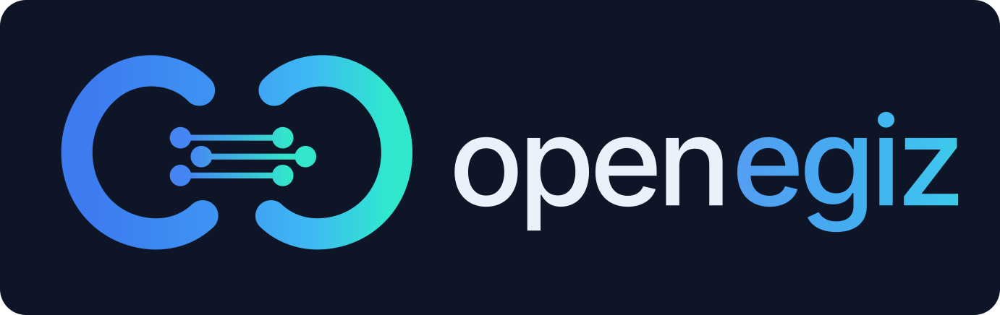

# OpenEgiz

<p align="center">
  
</p>

[Русская версия](README.ru.md)

OpenEgiz is an open-source industrial digital twin platform. Model physical assets as Twins in Eclipse Ditto, send live Telemetry over MQTT, and follow asset state and history in Grafana dashboards and optional 3D Scenes.

## Quick start (Docker Compose)

Install Docker with Compose v2.20 or newer, Git, and Make. Allocate at least 6 GiB of memory to Docker. The platform supports Linux `amd64` and `arm64` containers. On Windows, run the commands in WSL2 with Docker integration enabled.

```bash
git clone https://github.com/openegiz-io/openegiz.git
cd openegiz
make up
make example-mine
make smoke
```

`make up` starts the Dev Profile on `127.0.0.1`. On the first run it writes generated credentials to `deploy/compose/.env` and builds the Extended API and Plugin Bundle from source. Open Grafana at `http://localhost:3000` with the printed `admin` login. Find the mine dashboard under **Dashboards → OpenEgiz Examples → Example Mine** and its Twins under **OpenEgiz → Twins**. Run `make generate-data` for the smaller [Example Oven](examples/oven/).

`make down` stops the stack and retains data. `make clean` deletes the Compose volumes and generated credentials.

## Deploy a release

For prebuilt images, check out a [release tag](https://github.com/openegiz-io/openegiz/releases) such as `v2.0.0`, set `OPENEGIZ_RELEASE` to its version without `v`, and use Compose v2.24.4 or newer. The [Compose guide](docs/docker-compose.md) covers this and the Production Profile, which uses Caddy for HTTPS, authenticates MQTT clients, and keeps storage and the Extended API on the container network.

On Kubernetes, install the [OCI Helm chart](docs/kubernetes.md) from GHCR. The chart includes persistent storage for 3D Scenes, accepts a Kubernetes Secret managed outside Helm, and supports TLS Ingress for Grafana, Ditto, and the 3D Scene server.

Coming from v1.x? Follow the [migration guide](MIGRATION.md) to move Twins, Policies, Telemetry history, and dashboards to v2.

## Documentation

- [Architecture](docs/architecture.md) and [glossary](GLOSSARY.md)
- [Docker Compose](docs/docker-compose.md) and [Kubernetes with Helm](docs/kubernetes.md)
- [Security and hardening](docs/security.md) and [private vulnerability reporting](SECURITY.md)
- [Twins and Telemetry](docs/twins-and-telemetry.md), [Reference Examples](examples/), and [3D Scenes](docs/3d-scenes.md)
- [Documentation index](docs/README.md), [changelog](CHANGELOG.md), and [roadmap](ROADMAP.md)

## Contributing and license

See [Contributing](CONTRIBUTING.md) and the [Code of Conduct](CODE_OF_CONDUCT.md) before opening an issue or pull request.

OpenEgiz code is [MIT](LICENSE). Work derived from [OpenTwins](https://github.com/ertis-research/opentwins) by ERTIS Research at the University of Málaga, including the Grafana plugins, remains under the [Apache License 2.0](LICENSES/Apache-2.0.txt). See [NOTICE](NOTICE) for attribution.
