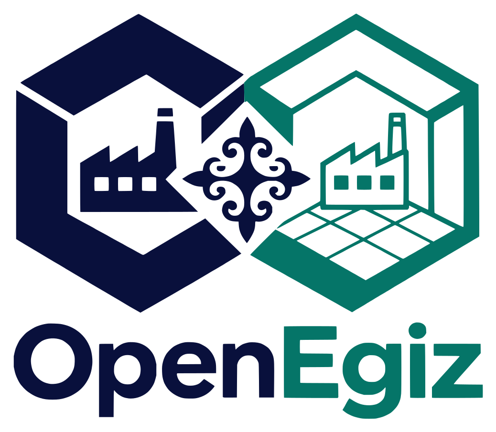
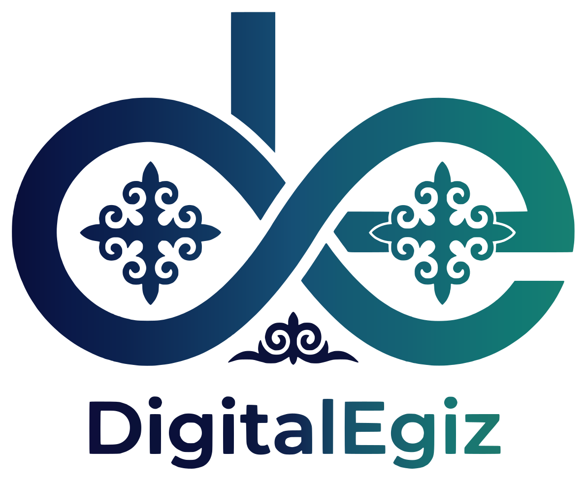

# OpenEgiz

<p align="center">
  <picture>
    <source media="(prefers-color-scheme: dark)" srcset="docs/img/openegiz-logo-dark.svg">
    <source media="(prefers-color-scheme: light)" srcset="docs/img/openegiz-logo-light.svg">
    
  </picture>
</p>

[English version](README.md)

OpenEgiz — открытая платформа промышленных цифровых двойников. Создавайте двойников оборудования в Eclipse Ditto, передавайте телеметрию по MQTT и следите за состоянием и историей оборудования на дашбордах Grafana и в 3D-сценах.

## Быстрый запуск через Docker Compose

Установите Docker с Compose версии 2.20 или новее, Git и Make. Выделите Docker хотя бы 6 ГиБ памяти. Платформа работает в Linux-контейнерах на `amd64` и `arm64`. В Windows запускайте команды внутри WSL2 с включённой интеграцией Docker.

```bash
git clone https://github.com/openegiz-io/openegiz.git
cd openegiz
make up
make example-mine
make smoke
```

`make up` запускает профиль разработки на `127.0.0.1`. При первом запуске команда сохраняет сгенерированные пароли в `deploy/compose/.env` и собирает Extended API и пакет плагинов Grafana из исходников. Откройте Grafana по адресу `http://localhost:3000` и войдите под именем `admin` с паролем, который напечатала команда. Дашборд рудника находится в **Dashboards → OpenEgiz Examples → Example Mine**, а его двойники — в **OpenEgiz → Twins**. Команда `make generate-data` запускает более простой [пример с печами](examples/oven/).

`make down` останавливает платформу и сохраняет данные. `make clean` удаляет тома Compose и сгенерированные пароли.

## Развёртывание релиза

Чтобы запустить готовые образы, перейдите на [тег релиза](https://github.com/openegiz-io/openegiz/releases), например `v2.0.0`, задайте в `OPENEGIZ_RELEASE` версию без начальной `v` и используйте Compose 2.24.4 или новее. [Руководство по Compose](docs/docker-compose.md) описывает этот способ запуска и профиль для рабочих серверов. В этом профиле Caddy обслуживает HTTPS, брокер проверяет учётные данные клиентов MQTT, а хранилища и Extended API доступны внутри сети контейнеров.

Для Kubernetes установите [чарт Helm в формате OCI](docs/kubernetes.md) из GHCR. Чарт предусматривает постоянное хранилище для 3D-сцен и позволяет подключить Kubernetes Secret, которым управляют отдельно от Helm, и настроить TLS Ingress для Grafana, Ditto и сервера 3D-сцен.

Если у вас установлена версия v1.x, [руководство по миграции](MIGRATION.md) поможет перенести в v2 двойников, политики доступа, историю телеметрии и дашборды.

## Документация

- [Архитектура](docs/architecture.md) и [глоссарий](GLOSSARY.md)
- [Docker Compose](docs/docker-compose.md) и [Kubernetes с Helm](docs/kubernetes.md)
- [Автономное развёртывание и резервная копия на NAS](docs/offline-bundle.md)
- [Безопасное развёртывание](docs/security.md) и [конфиденциальные сообщения об уязвимостях](SECURITY.md)
- [Двойники и телеметрия](docs/twins-and-telemetry.md), [примеры](examples/) и [3D-сцены](docs/3d-scenes.md)
- [Оглавление документации](docs/README.md), [история изменений](CHANGELOG.md) и [планы проекта](ROADMAP.md)

## Участие в проекте и лицензия

Прежде чем открыть задачу или pull request, ознакомьтесь с [правилами участия](CONTRIBUTING.md) и [кодексом поведения](CODE_OF_CONDUCT.md).

Код OpenEgiz распространяется по лицензии [MIT](LICENSE). Компоненты на основе [OpenTwins](https://github.com/ertis-research/opentwins) группы ERTIS Research Университета Малаги, включая плагины Grafana, сохраняют лицензию [Apache License 2.0](LICENSES/Apache-2.0.txt). Сведения об авторах и источниках приведены в [NOTICE](NOTICE).

## Разработка и поддержка

<p>
  <a href="https://digitalegiz.kz">
    <picture>
      <source media="(prefers-color-scheme: dark)" srcset="docs/img/digitalegiz-logo-dark.svg">
      <source media="(prefers-color-scheme: light)" srcset="docs/img/digitalegiz-logo-light.svg">
      
    </picture>
  </a>
</p>

OpenEgiz разрабатывает и поддерживает **DigitalEgiz Lab** на кафедре искусственного интеллекта и Big Data Казахского национального университета имени аль-Фараби (КазНУ), Алматы, Казахстан.

- [digitalegiz.kz](https://digitalegiz.kz) — DigitalEgiz Lab
- [openegiz.kz](https://openegiz.kz) — OpenEgiz
- [github.com/openegiz-io](https://github.com/openegiz-io) — организация на GitHub
