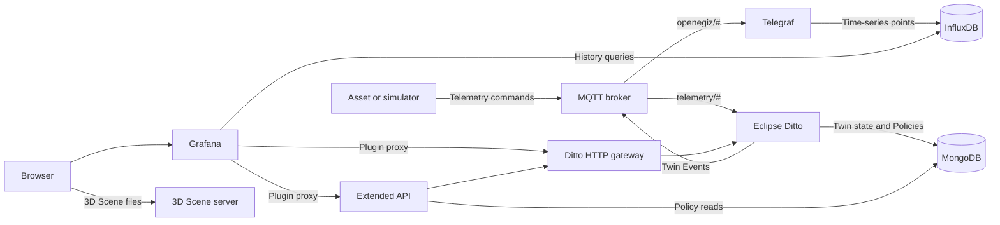

# Architecture

OpenEgiz keeps the latest state of a Twin separate from the history of its Telemetry.

- Ditto stores the current attributes and features of each Twin and evaluates its Policy. The initialization job creates the baseline Policy and the MQTT source and target connections on installation.
- Mosquitto receives Telemetry commands and delivers Twin Events to Telegraf or external subscribers. Telegraf writes history to InfluxDB in organization `openegiz`, bucket `default`.
- The Extended API aggregates Twin, Twin Type, and Policy operations for the OpenEgiz app in Grafana. The Plugin Bundle installs that app and the Unity panel before Grafana starts. The browser reaches Ditto and the Extended API through Grafana's server-side plugin proxy.
- The browser fetches 3D Scene files separately, from a host directory in Compose or a PVC-backed server in Helm. A dashboard can pass Twin data to the panel and receive selections from the scene.

[Docker Compose](docker-compose.md) adds host networking for local work or Caddy for HTTPS. [Kubernetes](kubernetes.md) uses ClusterIP Services and optional TLS Ingress. Both retain Twin state, Telemetry history, and Grafana state in persistent storage across routine restarts.

See the [glossary](../GLOSSARY.md) for domain terms and the [decision records](adr/) for rationale.
